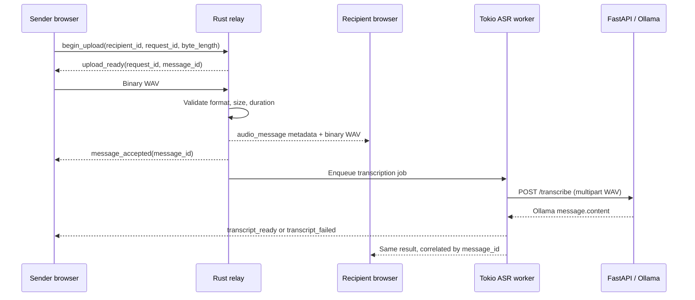

# Architecture

The system separates transport from inference. A slow model should delay the transcript, not delivery of the recorded voice message.

The arrows to browsers represent queued outgoing messages, not end-to-end receipt guarantees.

## Frontend

RecordRTC records microphone input into a complete PCM WAV. React renders the people, chats, and conversation views. Zustand keeps session, upload, and chat state. Components are grouped under `src/components/`; recording, transport, protocol parsing, and stores are separate modules.

The upload state advances from idle to recording, requesting an upload grant, uploading, and back to idle or failure. JSON controls and binary audio share one WebSocket. Incoming metadata is held until the immediately following WAV arrives. Each transcript updates its matching message rather than appending an unrelated chat item.

The browser reconnects with backoff. A new welcome event resets chat state because the server assigns a new identity. Recording and chat history are not recoverable across that reset.

## Rust relay

A shared state mutex protects connected users and pending uploads. Each connection has a reader, a writer, and a bounded outgoing queue. WAV validation occurs outside the mutex; socket writes and ASR HTTP calls do not hold it.

A recipient's metadata and WAV are queued as one batch, preserving their adjacency when multiple people send concurrently. Each sender may have one pending upload. Recipients are not reserved, and `busy` means only that an outgoing upload is pending.

Presence snapshots are broadcast after connections, disconnections, names, and upload state change. There is no separate persistent user registry.

## Transcription

After successful audio queueing, Rust submits a job containing the original message ID, participant IDs, and WAV bytes. One worker processes jobs sequentially through a reused HTTP client.

FastAPI reads the WAV and sends base64 audio to `frozenlab/qwen3-asr:0.6b` through Ollama. The assistant prefix selects English. Rust extracts the text from `message.content`, strips an ASR marker if present, and rejects empty output. Both participants receive the result through their existing connection queues.

Inference is local and does not call a hosted AI API. 
